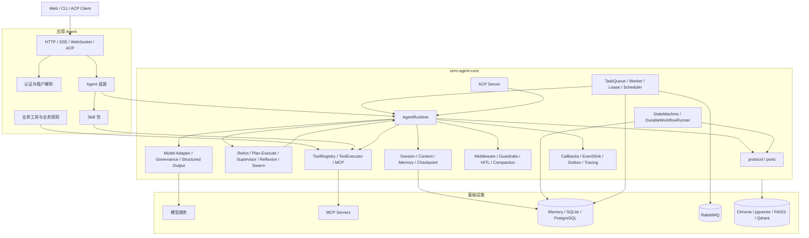
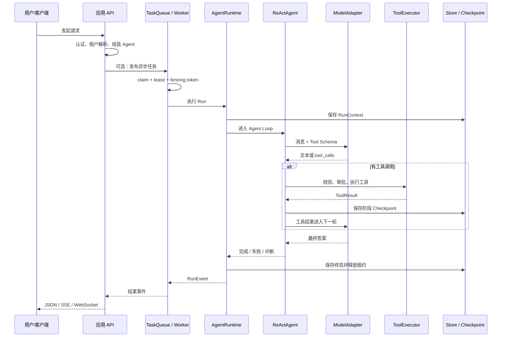

# Agent 开发知识体系与系统架构

本文以 `zero-agent-core` 为样本，整理 Agent 开发岗位需要掌握的知识结构，并说明本项目的实际架构。
它同时面向两类读者：准备 Agent 开发面试的工程师，以及需要理解系统边界和运行链路的新成员。

模块细节以 [系统架构](./ARCHITECTURE.md) 为准，能力实现状态以 [已实现能力](./CAPABILITIES.md) 为准。
本文负责建立知识地图和整体认知，不在多个位置重复维护同一份模块清单。

## 阅读路径

| 目标 | 建议阅读顺序 |
| --- | --- |
| 快速理解项目 | 四层能力模型 → 总体架构 → 一次请求链路 → 可靠性设计 |
| 准备面试 | 知识地图 → 系统架构 → 岗位能力矩阵 → 面试速查 |
| 参与开发 | 系统架构 → 模块职责 → 状态模型 → 能力缺口 → 对应权威文档 |

## 一、四层能力模型

Agent 开发不是“调用大模型 API 加 Prompt”。一个可用于生产的 Agent 系统至少包含四层能力：

```text
L1 模型与 AI 基础
   Token、上下文、推理、结构化输出、Embedding

L2 Agent 认知与编排
   ReAct、Planning、Reflection、Multi-Agent、Tool Use

L3 Agent 平台工程
   Runtime、工具系统、状态、存储、队列、权限、可观测性

L4 生产化与评估
   成本、延迟、可靠性、安全、评测、灰度、故障处理
```

只会 L1 和 L2，可以做出演示程序；能够把四层打通，才具备 Agent 工程师的完整能力。
本项目的主要优势集中在 L3，并对 L2 和 L4 有较完整的工程支撑。

## 二、Agent 开发知识地图

### 1. LLM 基础

需要掌握 Token 与上下文窗口、输入输出成本、Temperature 和 Top-p、消息角色、Function Calling、
Streaming、Embedding、JSON Schema 以及模型幻觉的成因。

项目中由以下模块承接：

- `model/` 统一 `ModelAdapter`、Provider 注册和模型工厂；
- `model/structured.py` 处理 JSON 提取、Schema 校验和失败重试；
- `model/governance.py` 处理并发、限流、超时、熔断和 fallback；
- `compaction/` 处理 Token 估算、消息裁剪和上下文溢出恢复。

需要能回答的问题包括：为什么 Agent 必须限制迭代次数，为什么流式输出会提高重试难度，
为什么业务数据不能只靠模型自由文本返回，以及上下文溢出时如何降级。

待补能力：Transformer、Attention、推理参数和模型服务性能优化属于独立理论基础，
不能仅靠阅读运行时代码掌握。

### 2. Prompt 与上下文工程

需要掌握 System Prompt 与业务 Prompt 的职责、Few-shot、ReAct Prompt、Planning Prompt、
Tool Description、上下文裁剪、摘要压缩、结构化上下文以及 Prompt Injection 防护。

核心原则是：

> 关键业务状态保存在结构化状态中，Prompt 只承载模型当前推理所需的上下文。

项目中的 `prompts/` 提供安全模板和版本管理，`compaction/` 提供摘要、裁剪、工具结果瘦身和 spill，
`middleware/injection_guard.py` 提供 Prompt Injection 防护。Session、Context 和 Memory 分别保存
不同生命周期的状态，避免把所有信息都塞进消息历史。

面试追问通常是“压缩会不会丢信息”。答案是会，因此关键状态必须进入 Memory、Checkpoint 或结构化协议，
压缩后的自然语言上下文主要保留任务摘要和最近交互。

### 3. Agent 执行范式

项目内置五种模式，统一定义在 `runtime/modes.py`，通过 `SupportsRun` 和 `AgentOutput` 组合。

| 模式 | 适合的任务 | 主要代价 |
| --- | --- | --- |
| ReAct | 动态探索、普通工具调用 | 缺少全局计划，长任务容易偏离 |
| Plan-Execute | 步骤明确、依赖清晰的多阶段任务 | 规划和汇总增加模型调用与延迟 |
| Supervisor | 能力边界清晰、需要集中路由的任务 | 控制 Agent 容易成为瓶颈 |
| Reflexion | 质量敏感、可自动评审的任务 | 调用次数和成本增加 |
| Swarm | Agent 之间需要自治移交的任务 | 路由复杂，必须限制 handoff 白名单 |

ReAct 的基本循环是：

```text
Reason -> Act -> Observe -> Reason -> ... -> Answer
```

`ReActAgent` 限制最大迭代次数和工具调用次数，并把空响应、模型失败、审批暂停和租约丢失收敛为明确状态。
`run()` 与 `stream()` 共享 `_iterate()` 执行内核，只通过 `_LoopMode` 区分普通调用和流式调用，
避免两套执行语义长期漂移。

Plan-Execute 将计划建模为依赖图：先校验步骤 ID、依赖、指令和数量，再根据依赖完成情况构造可执行批次，
通过 `max_parallel_steps` 并行执行同层步骤，并用 `max_context_chars` 限制跨步骤上下文。

Reflexion 执行“生成、评审、修订、再评审”；Supervisor 负责选择子 Agent；Swarm 使用成员级 handoff
白名单，并拒绝重复移交边。项目允许高级模式嵌套 ReAct，但编排结果最终由 `AgentRuntime` 统一收口 Run 终态。

### 4. 工具调用系统

工具系统需要掌握 Schema 设计、参数校验、工具选择、并发、超时、异常分类、幂等、审批、结果裁剪、
MCP 接入以及 Skill 与工具绑定的区别。

`ToolSpec` 除了名称和描述，还声明：

| 字段 | 作用 |
| --- | --- |
| `parameters` | 工具参数 JSON Schema |
| `risk_level` | 风险等级 |
| `requires_approval` | 是否需要人工审批 |
| `idempotent` | 是否允许安全重试 |
| `timeout_seconds` | 单次执行超时 |
| `priority` | 调度优先级 |
| `phase` | 执行阶段 |

`ToolRegistry` 负责描述和注册工具，`ToolExecutor` 负责参数校验、并发限制、同步函数线程隔离、审批、
超时、错误包装和调用统计。工具系统因此是一个策略执行器，而不是函数名到函数的简单映射。

高优先级工具失败时，Agent Loop 会阻断更低优先级工具，避免继续产生无效副作用。MCP 工具与本地 Function
使用同一套 Tool Schema 暴露给模型，应用层决定具体 MCP Server、认证方式和允许使用的工具集合。

### 5. Agent 状态管理

Agent 的状态具有不同生命周期，不能混在一个字典里：

| 状态 | 生命周期 | 作用 |
| --- | --- | --- |
| Session | 多轮会话 | 保存消息历史 |
| Context | 单个 Thread | 保存结构化业务上下文和引用 |
| Memory | 跨 Session | 保存可检索的长期记忆 |
| RunContext | 一次 Run | 保存状态、事件、迭代次数和 checkpoint |
| Checkpoint | 执行节点 | 支持恢复、回滚和时间旅行 |
| WorkflowExecution | 工作流实例 | 保存状态机进度和节点结果 |

项目通过 `AccessContext` 给 Session、Memory、Approval 和检索数据增加用户与租户边界。
严格模式下，创建 Run、查询历史、恢复和取消都必须携带访问上下文。

面试时可以把 Agent 描述为：

> 一个带外部副作用、需要跨多轮保存状态，并且必须能够从失败中恢复的状态机。

### 6. 持久化与恢复

需要掌握 Checkpoint 保存时机、幂等恢复、中断续跑、历史版本、原子写入、事务、状态版本迁移和
多实例一致性。

项目在每轮模型调用和工具调用后保存快照；并发工具按完成进度保存阶段快照，恢复时只继续尚未完成的任务。
文件 Checkpoint 使用同目录临时文件、`fsync` 和原子替换，避免进程崩溃后留下截断 JSON。
`TimeTravelCheckpointer` 提供版本读取、回滚、删除和数量上限；序列化使用显式类型白名单和 Schema 版本，
不使用 `pickle` 或输入中的 Python 类路径。

存储后端按环境选择：

| 环境 | 默认组合 |
| --- | --- |
| test | Memory Store + Memory TaskQueue |
| development | SQLite Store + Memory TaskQueue |
| production | PostgreSQL Store + RabbitMQ TaskQueue |

### 7. 幂等、重试与副作用控制

需要掌握至少一次执行与 exactly-once 的区别、幂等键、退避重试、临时失败与永久失败、死信队列、
结果缓存和乐观并发控制。

非幂等工具必须提供稳定 `operation_id`，执行流程为：

```text
claim(operation_id)
  -> 已完成：返回缓存结果
  -> 正在执行：返回可重试状态
  -> 获得所有权：执行工具
  -> 成功后保存结果
```

运行时可以保证操作记录去重和幂等提交，但外部系统是否 exactly-once 取决于下游是否支持幂等键、
事务或去重机制。这个边界必须在系统设计中说清楚。

### 8. 分布式任务执行

需要掌握任务队列、Worker 并发、Lease、Heartbeat、过期回收、Fencing Token、重试、死信队列和
多实例部署。

Lease 解决“当前谁有权执行”，Fencing Token 解决“旧执行者恢复后还能不能写入”。

典型故障是 Worker A 因网络阻塞失去租约，Worker B 接管并完成任务，A 恢复后提交旧结果。
每次重新认领都会递增 fencing token，存储层据此拒绝 A 的迟到写入；Worker 在检测到失租后还会取消当前 Handler，
减少无效执行。

任务状态流转为：认领、执行、成功提交；临时失败进入重试；永久失败进入死信；过期租约由调度器回收。
按 intent 设置的并发信号量用于隔离不同任务类型的资源消耗。

### 9. RAG 与知识检索

需要掌握文档加载、解析、Chunk 切分、Embedding、向量检索、关键词检索、Hybrid Search、Rerank、
Metadata Filter、权限过滤、来源定位和检索评估。

项目中的 `documents/` 保存来源、checksum、页码和字符区间；`retrieval/` 提供 Memory、Chroma、
pgvector、FAISS、Qdrant 适配器以及 Hybrid 检索和 Reranker 端口。向量查询支持 namespace、metadata
和 `AccessContext` 隔离。

还需要补足真实知识库上的实践：Recall@K、MRR、NDCG 评测，Chunk 大小和重叠实验，检索结果进入 Prompt 的
组织方式，以及答案引用如何回链到原文。

### 10. 安全与权限

需要掌握认证、租户隔离、RBAC、工具权限、数据权限、Prompt Injection、PII 脱敏、密钥管理、审计、
人工审批和不可信序列化。

项目通过 `AccessContext` 和 `enforce_access` 维护用户、租户、角色和资源边界；通过 `GuardrailsMiddleware`
处理关键词、长度、PII 和输出格式检查；通过 `HumanInTheLoopMiddleware` 和 `ApprovalQueue` 支持持久化审批。

安全判断不能只看模型输出，必须在工具执行和数据访问边界再次验证权限。业务安全规则仍由应用层负责，
Core 只提供通用访问控制和执行机制。

### 11. 可观测性与评估

需要掌握结构化日志、Metrics、Trace、RunEvent、模型与工具耗时、Token 成本、任务成功率和 Agent 评估集。

项目通过 `RunContext` 生成带全局序号的 `RunEvent`，记录 parent run、组件、tags、metadata、usage、
错误和耗时；`CallbackManager` 负责进程内订阅并隔离订阅者超时与异常；`EventSink` 向外部发送事件；
`EventOutbox` 先持久化再投递，`RetryingEventSink` 处理临时失败。

Callback 只观察已经发生的事件，不能修改执行流程；Middleware 位于执行链中，可以修改、停止或要求重试。

Agent 评估不能只看回答是否“像”。至少应覆盖：

| 指标 | 说明 |
| --- | --- |
| 任务完成率 | 最终是否完成用户目标 |
| 工具调用成功率 | 是否正确选择和执行工具 |
| 平均步骤数 | 是否存在低效绕路 |
| Token 与成本 | 单任务经济性 |
| P95 延迟 | 用户体验 |
| 重试率 | 系统稳定性 |
| 幻觉率 | 答案是否有可靠依据 |
| 检索命中率 | RAG 是否召回正确资料 |

### 12. 部署与工程化

需要掌握异步编程、FastAPI、SSE、WebSocket、PostgreSQL、Redis、RabbitMQ 或 Kafka、Docker、配置中心、
灰度发布、限流、熔断、降级、日志和告警。

需要能解释 Event Loop、Task 取消、超时、`Semaphore`、`Lock`、线程池和任务泄漏。
项目中的 Worker 心跳、工具并发、模型治理和失败取消都依赖这些基础能力。

项目已经覆盖大部分运行时机制，但真实生产流量、容量规划、故障演练和成本优化仍需要额外实践。

## 三、项目系统架构

### 1. 总体分层



应用层负责 Prompt、业务工具、业务规则和协议适配；Core 负责模型、Skill、工具、Agent Loop、运行生命周期、
上下文、记忆、审批、工作流、持久化、可观测性和 ACP。Core 不包含 HTTP 路由、低空业务语义或业务实体投影。

### 2. 模块职责

| 模块 | 职责 | 关键设计 |
| --- | --- | --- |
| `protocol` | 跨模块公共数据契约 | 只定义数据结构，不承载业务规则 |
| `ports` | 外部能力接口 | Store、Sink、Queue、ConfigCenter 等可替换端口 |
| `runtime` | Run 生命周期和 Agent Loop | 状态、事件、恢复、取消、租约 |
| `model` | 模型适配与治理 | Provider、结构化输出、限流、熔断、fallback |
| `tools` | 工具注册与执行 | Schema、审批、超时、并发、幂等 |
| `skills` | 能力包加载与激活 | 清单校验，不动态导入 Python |
| `mcp` | MCP 工具接入 | 工具发现、调用、超时和统一错误 |
| `middleware` | 执行横切能力 | 安全、审计、缓存、压缩、降级 |
| `hitl` | 人工审批 | 持久化审批、超时、跨进程同步 |
| `workflow` | 确定性流程编排 | 节点策略、重试、幂等、恢复 |
| `tasks` | 异步任务执行 | 队列、Worker、Lease、DLQ |
| `storage` | 默认持久化实现 | Memory、SQLite、PostgreSQL |
| `retrieval` | 文档与向量检索 | 多后端、权限隔离、Hybrid |
| `observability` | 运行观测 | Metrics、Trace、健康检查 |
| `acp` | Agent 协议 | JSON-RPC / stdio、会话、更新和取消 |

模块、端口和存储对象的完整定义见 [系统架构](./ARCHITECTURE.md)；已实现能力和边界见
[已实现能力](./CAPABILITIES.md)。

### 3. 一次请求的执行链路



同步调用可以跳过 TaskQueue，由应用直接调用 `AgentRuntime`；后台运行、多实例 Worker 和 RabbitMQ 队列用于
需要异步执行、削峰或跨进程恢复的场景。两条路径复用同一个 Runtime 和 Agent Loop。

### 4. 可靠性设计

本项目的可靠性由五个机制共同保证：

1. **Checkpoint**：保存执行位置和阶段结果，支持恢复；
2. **Idempotency**：防止重复创建 Run，并对非幂等工具做结果去重；
3. **Lease + Fencing Token**：防止多个 Worker 同时执行，以及旧 Worker 迟到写入；
4. **Retry + DLQ**：区分临时失败与永久失败，保留任务重试信息；
5. **Event Outbox**：事件先落库再投递，降低消息总线故障造成的事件丢失。

这五个机制共同回答一个问题：当进程崩溃、网络抖动、消息重复或 Worker 失联时，任务还能不能保持正确。

### 5. 架构边界

项目刻意保持以下边界：

- Core 不包含低空业务语义、HTTP 路由和业务实体投影；
- Core 不依赖 LangChain 或 LangGraph；
- 应用层负责 Prompt、业务工具、业务规则和 API；
- 外部系统差异通过 Adapter 解决；
- 通用能力必须有稳定契约、默认实现和测试；
- 模型、MCP、PostgreSQL 等 SDK 放在 optional extras 中，并按需延迟导入。

这种边界让 Core 可以服务不同 Agent 项目，而业务系统仍然保留自己的领域模型和部署方式。

## 四、岗位能力矩阵

| 岗位要求 | 本项目覆盖情况 | 可展开的内容 |
| --- | --- | --- |
| Agent 原理 | 强 | ReAct、Plan-Execute、Reflexion、Supervisor、Swarm |
| 工具调用 | 强 | Schema、审批、超时、并发、幂等 |
| 异步编程 | 强 | 取消、超时、并发工具、Worker 心跳 |
| 分布式可靠性 | 强 | Lease、Fencing Token、Outbox、DLQ |
| 状态与持久化 | 强 | Checkpoint、恢复、时间旅行、多后端 |
| 架构设计 | 强 | Protocol、Ports、Adapter、Middleware |
| RAG | 中强 | 文档、切分、Embedding、向量库、权限 |
| 模型工程 | 中强 | Provider、结构化输出、治理、降级 |
| 安全 | 中强 | RBAC、AccessContext、Guardrails、HITL |
| 评估体系 | 待补 | 需要真实评测集和指标实践 |
| 线上运维 | 待补 | 需要真实流量、容量和故障演练 |
| 模型理论 | 待补 | Transformer、Attention、推理优化 |

面向 Agent 应用开发和 Agent 平台工程岗位，项目已经能够支撑有深度的技术面试。
面向算法研究或更高阶架构岗位，还需要补充模型理论、评估实验和大规模线上治理经验。

## 五、面试速查

### 一分钟项目介绍

> 我负责的是一个零外部平台绑定的 Python Agent Runtime Core。它通过 Protocol、Ports 和
> Storage Adapter 解耦运行时与具体基础设施，支持 ReAct、Plan-Execute、Supervisor、Reflexion、
> Swarm 五种执行模式。项目重点解决 Agent 在生产环境中的可靠性问题，包括工具幂等、Checkpoint
> 恢复、Worker Lease、Heartbeat、Fencing Token、事件 Outbox、超时、重试和多租户访问控制。
> 核心目标不是让模型能回答，而是让 Agent 在并发、失败、重试和进程重启后仍然能够正确运行。

### 高频追问

**为什么需要 Fencing Token？**

Lease 过期后旧 Worker 可能恢复并迟到写入。Fencing Token 让存储层识别新旧执行者，拒绝旧 Worker 的结果提交。

**为什么不把所有逻辑写进 ReAct？**

这样会让权限、审计、压缩、重试和业务执行强耦合。Middleware 负责横切能力，Ports 负责隔离外部依赖。

**为什么工具要区分幂等和非幂等？**

失败重试可能重复产生外部副作用。幂等工具可以直接重试；非幂等工具必须有稳定 operation_id 和结果去重。

**Plan-Execute 一定比 ReAct 好吗？**

不一定。Plan-Execute 适合依赖清晰的复杂任务，ReAct 更适合动态探索；前者规划成本更高，也可能出现计划过时。

**Callback 和 Middleware 有什么区别？**

Callback 观察已经发生的事件；Middleware 位于执行链中，可以修改输入、停止执行或要求重试。

**Agent 能做到 exactly-once 吗？**

运行时可以通过幂等键、操作记录和 fencing token 降低重复副作用，但外部系统是否 exactly-once
取决于下游协议和存储能力。

**如何验证可靠性设计？**

重点测试租约丢失、旧 Worker 写入、重复 operation_id、工具超时、事件投递失败、Checkpoint 恢复和
并发边界，而不是只测试模型正常返回。

### 验证事实

2026-11-09 本地全量测试结果为 `483 passed`、`24 skipped`、`3 failed`。失败项包括两个既有 FAISS
检索测试，以及一个 Chroma 持久化测试；后者因临时目录无法打开数据库而失败，属于当前环境问题。
PostgreSQL 相关测试因未配置测试 DSN 而跳过。

引用测试结果时应同时说明执行时间和失败范围，不应把“绝大多数通过”表述为“全部通过”。

### 优先准备的主题

1. ReAct Loop 与状态机；
2. 工具幂等和至少一次执行；
3. Worker Lease 与 Fencing Token；
4. Ports and Adapters 分层架构；
5. Plan-Execute DAG 与多 Agent 编排。

这五个主题覆盖 Agent 原理、工程架构、分布式一致性、可靠性和系统设计，最适合体现项目深度。

## 六、学习路线与能力缺口

### 第一阶段：讲清项目

能够画出一次请求的完整链路，解释 ReAct Loop、工具幂等、Lease 与 Fencing Token、Checkpoint 恢复。

### 第二阶段：讲清取舍

能够解释为什么使用 Protocol 和 Ports，为什么 Callback 与 Middleware 分开，为什么 Plan-Execute 不一定优于 ReAct，
为什么事件投递只能做到至少一次，以及上下文压缩丢失信息时如何降低影响。

### 第三阶段：独立设计

能够设计支持恢复的 Agent 服务、工具权限和审批、RAG 检索与评估、多租户隔离、监控和告警。

### 第四阶段：证明效果

建立任务评测集，统计完成率、成本、延迟和工具成功率，对比 Prompt、模型与检索策略，执行故障注入和恢复测试，
并用数据说明优化收益。

### 需要继续补齐的能力

| 缺口 | 建议实践 |
| --- | --- |
| LLM 理论 | 学习 Transformer、Attention、推理参数和模型服务基础 |
| Agent 评估 | 建立固定任务集，统计完成率、成本、延迟和工具成功率 |
| RAG 质量 | 在真实语料上评估 Recall@K、MRR、NDCG，并做切分与 Rerank 对比 |
| 线上运维 | 做容量压测、故障注入、灰度发布和告警演练 |
| 现场编码 | 手写简化 ReAct Loop、带超时重试的异步调用和幂等任务消费者 |

## 七、常见失分点

1. 只会说“用了大模型”，说不清状态管理和失败处理；
2. 把 Function Calling 等同于 Agent；
3. 认为重试可以解决所有失败；
4. 忽略非幂等工具的重复副作用；
5. 认为 Lease 可以替代 Fencing Token；
6. 把 Callback 和 Middleware 混为一谈；
7. 只讲 RAG 流程，不讲检索评估；
8. 只说测试通过，不说失败范围和归因；
9. 不能解释为什么选择某种 Agent 模式；
10. 不能把架构设计和真实故障场景联系起来。

最终应形成的表达是：

> 我不是在项目里接入了大模型，而是设计了一套让 Agent 能够稳定运行的执行基础设施。
