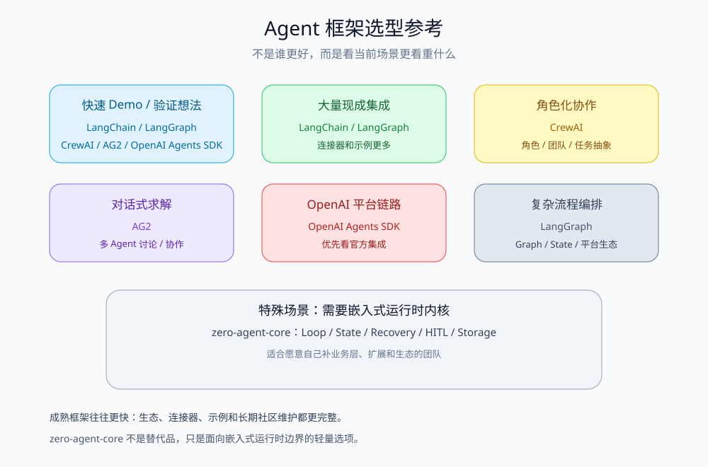

# 我发布了一个轻量 Python Agent 运行时内核：zero-agent-core

最近把 `zero-agent-core` 发到了 PyPI。它是一个零外部平台绑定的 Python Agent 运行时内核，定位不是“全家桶框架”，而是可复用的内核层：ReAct Loop、工具调用、MCP、Skill、上下文压缩、持久化恢复、工作流、HITL、多模型适配、ACP 协议这些通用能力都在内核里，业务侧的 HTTP、鉴权、提示词和数据模型都留给你自己接。

> PyPI：https://pypi.org/project/zero-agent-core/  
> GitHub：https://github.com/qiuzixu/agent-core

## 为什么要做这个

现在很多 Agent 框架开箱即用，但有两个问题我比较在意：

1. **核心能力和业务边界容易混在一起**  
   一旦框架替你决定了 API 层、会话管理、提示词结构、存储方式，你后面要接自己的业务系统就很别扭。

2. **依赖面太宽，试错成本高**  
   很多框架会直接把模型 SDK、向量库、平台客户端都带进来。可对一个长期项目来说，我更希望“装了哪个 SDK，就启用哪块能力；一个都不装，也能把内核跑起来”。

所以我做了一个很明确的取舍：

- Core 包本身 `dependencies = []`；
- 模型 SDK、MCP、pgvector、Chroma、MinerU、Embedding 都走 optional extras；
- 导入名统一是 `agent_core`，发行名是 `zero-agent-core`。

## 它能做什么

内核覆盖的是 Agent 应用运行时的通用闭环：

- 普通和流式 ReAct Agent Loop；
- Function Calling、MCP stdio 客户端、声明式 Skill；
- OpenAI / Anthropic / Gemini / Ollama / 自定义模型 Provider；
- JSON Schema 结构化输出；
- 模型限流、并发、超时、熔断和 fallback；
- Middleware、Guardrails、HITL 审批；
- 上下文摘要压缩、工具结果瘦身；
- 会话、长期上下文、审批、模型选择的 Memory / SQLite / PostgreSQL 存储；
- Worker 租约、心跳、重启恢复；
- Checkpoint 历史、回滚、节点重试、幂等写入；
- 多 Agent 编排扩展包；
- ACP JSON-RPC/stdio 服务端适配。

完整能力清单见仓库里的 `docs/CAPABILITIES.md`。

## 和 CrewAI / LangChain / LangGraph / AG2 / OpenAI Agents SDK 的取舍

先说清楚：它不是“更好的 Agent 框架”，更不是成熟框架的替代品。它的覆盖面小很多，生态、连接器、示例和社区资料也少很多。多数项目要快速验证或交付，成熟框架通常仍是更稳妥的选择。

| 场景 | 优先考虑 | 原因 |
| --- | --- | --- |
| 快速跑通 Demo / 验证想法 | LangChain / LangGraph / CrewAI / AG2 / OpenAI Agents SDK | 生态、文档和示例更丰富 |
| 需要大量现成集成 | LangChain / LangGraph | 连接器和社区实践更成熟 |
| 角色化多 Agent 团队 | CrewAI | 角色和协作抽象更直接 |
| 多 Agent 对话 / 协作讨论 | AG2 | 更偏对话式求解 |
| 深度使用 OpenAI 平台链路 | OpenAI Agents SDK | 与 OpenAI 相关工具和运行链路集成更顺 |
| 复杂流程编排 | LangGraph | 状态图、持久化和平台生态更成熟 |
| 需要嵌入式 Agent Loop、状态恢复、HITL 和自定义存储边界 | zero-agent-core | 把这层当作可嵌入内核；但生态、连接器和长期维护成本需要自己承担 |



如果只是写一个一次性 Demo，成熟框架大概率更快。这个项目的位置更像内核层：只有在系统已经明确需要可控 Agent Loop、持久化状态、审批恢复和可替换存储边界时，才值得考虑它。

## 快速上手
## 快速上手

```bash
pip install zero-agent-core
```

一个最小示例大概长这样：

```python
import asyncio
from agent_core import ReActAgent, ToolExecutor, ToolRegistry

def add(a: int, b: int) -> int:
    return a + b

registry = ToolRegistry()
registry.register(
    "add",
    add,
    "计算两个整数之和",
    parameters={
        "type": "object",
        "properties": {"a": {"type": "integer"}, "b": {"type": "integer"}},
        "required": ["a", "b"],
    },
)

agent = ReActAgent(
    llm=DemoModel(),  # 也可以换成 create_model_provider(config)
    tool_executor=ToolExecutor(registry),
    system_prompt="你是一个计算助手。",
    tool_definitions=registry.build_tool_definitions(),
)

asyncio.run(agent.run("帮我计算 20 + 22", thread_id="demo"))
```

如果你打算从源码跑示例，可以先安装 [uv](https://docs.astral.sh/uv/)：

```bash
# macOS / Linux
curl -LsSf https://astral.sh/uv/install.sh | sh

# Windows PowerShell
powershell -ExecutionPolicy ByPass -c "irm https://astral.sh/uv/install.ps1 | iex"
```

仓库里的 `examples/starter/starter_agent.py` 是一个离线可跑的完整示例，不需要 API Key，会依次演示：

- `run()` 阻塞式调用；
- `stream()` 流式输出；
- 一个 `requires_approval=True` 的写工具审批回调；
- 用 `FileCheckpointer` 做跨进程恢复。

## 架构上比较在意的一件事

我把依赖方向设计得很死：

```text
protocol / ports / access
        ↓
runtime
        ↓
model / tools / mcp / skills
        ↓
storage: Memory / SQLite / PostgreSQL
```

`runtime` 只依赖端口和协议，不反向依赖具体存储实现。这样业务应用可以在测试里跑内存实现，在本地跑 SQLite，在生产里换 PostgreSQL，核心代码不用改。

## 目前状态

项目现在还是 `0.2.0` Alpha，要求 Python 3.13。公开 API 在 `0.x` 阶段可能调整。

目前也有几个明确限制：

- 租约还没有实现 fencing token；
- PostgreSQL 集成测试待补；
- 部分子系统的测试覆盖还在加强；
- Core 不包含 HTTP/API 层、鉴权、业务提示词和业务数据模型。

这些不是隐藏问题，我更愿意把它当作一个可以读源码、可以替换端口、可以按需组合的内核来用。

## 安装

```bash
pip install zero-agent-core
```

如果需要真实模型：

```bash
pip install "zero-agent-core[openai]"
pip install "zero-agent-core[anthropic]"
pip install "zero-agent-core[gemini]"
pip install "zero-agent-core[models,mcp,production]"
```

如果需要扩展能力：

```bash
pip install zero-agent-core-mineru
pip install "zero-agent-core-embeddings[openai]"
pip install zero-agent-core-multi-agent
```

## 仓库

- GitHub：https://github.com/qiuzixu/agent-core
- PyPI：https://pypi.org/project/zero-agent-core/

如果你也在做需要可控 Agent 运行时的项目，欢迎提 issue 或者 PR。
