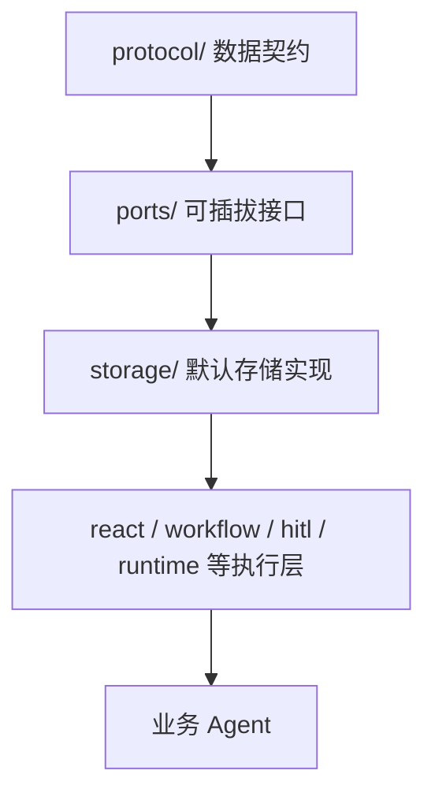
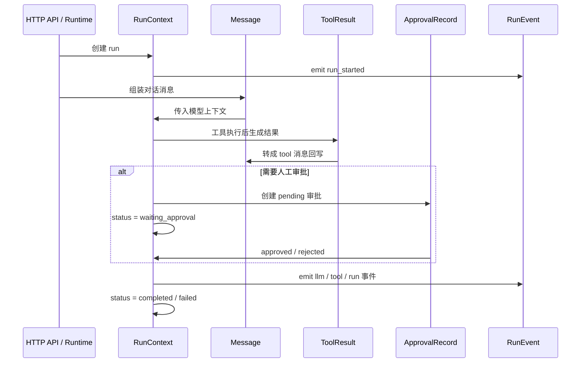
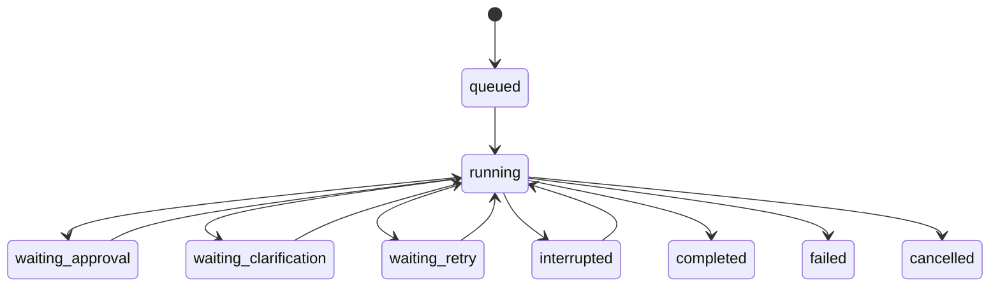
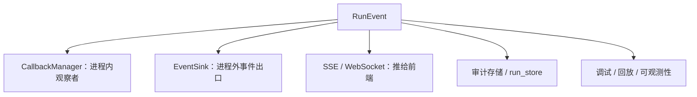

# 协议总览

`protocol/` 是 Agent Core 的公共数据契约层。它不执行业务流程，不访问存储，也不调用模型；
它的职责是让 ReAct、Workflow、HITL、Runtime、HTTP API、事件系统和存储层使用同一套数据语言。

## 1. 模块定位



`protocol/` 只回答“数据长什么样”；可替换能力接口放在 `ports/`，默认实现放在 `storage/`。
因此这里禁止放置 HTTP Schema、业务 DTO、项目配置或某个具体 Agent 的业务语义。

## 2. 核心类型

| 类型 | 位置 | 职责 |
| --- | --- | --- |
| `Message` | `messages.py` | 一条对话消息，支持 `system` / `user` / `assistant` / `tool` |
| `RunContext` | `runtime.py` | 一次 Agent run 的完整现场和可恢复上下文 |
| `RunEvent` | `runtime.py` | 一次 run 的生命周期事件流水 |
| `ToolResult` | `runtime.py` | 工具执行结果的结构化表达 |
| `ApprovalRecord` | `runtime.py` | 一次 HITL 审批请求和终态审计记录 |
| `AgentCapabilities` | `capabilities.py` | Agent 服务对外暴露的能力声明 |

## 3. 一次 run 的生命周期



一个 `thread_id` 代表一个会话，一个 `run_id` 代表该会话中的一次运行。
一个会话可以包含多个 run。

## 4. Message

`Message` 是 Core 内部的统一消息结构：

```python
Message(
    role="assistant",
    content="...",
    tool_calls=[
        {
            "id": "call-1",
            "name": "search_airport",
            "args": {"keyword": "深圳"},
        }
    ],
)
```

它有两个序列化出口：

- `to_dict()`：Core 内部扁平格式，供存储、checkpoint 和测试使用。
- `to_openai_dict()`：OpenAI-compatible API wire 格式，其中 `arguments` 是 JSON 字符串。

四个工厂函数用于语义化构造消息：

- `system_message()`
- `user_message()`
- `assistant_message()`
- `tool_message()`

## 5. RunContext

`RunContext` 表示一次运行现场的完整快照。

核心字段：

| 字段 | 含义 |
| --- | --- |
| `thread_id` | 会话 ID |
| `run_id` | 本次运行 ID |
| `user_id` / `tenant_id` | 发起者和租户 |
| `status` | 当前运行状态 |
| `schema_version` | 协议版本，当前默认 `1` |
| `iteration` | ReAct 迭代轮数 |
| `tool_calls_used` | 工具调用预算计数 |
| `pending_approval` | 待处理 HITL 审批 |
| `pending_clarification` | 待澄清信息 |
| `state` | 运行时业务状态 |
| `checkpoint` | 可序列化的恢复快照 |
| `checkpoint_callback` | 进程内回调，不参与序列化 |
| `events` | 当前 run 内的事件流水 |

`RunContext` 可以通过 `to_dict()` 持久化，并通过 `from_dict()` 恢复。
恢复时不会恢复 `checkpoint_callback`，因为函数回调无法稳定序列化，也不应该跨进程传递。

## 6. RunStatus

`RunStatus` 描述一次 run 的生命周期状态：

- `queued`
- `running`
- `waiting_approval`
- `waiting_clarification`
- `waiting_retry`
- `interrupted`
- `completed`
- `failed`
- `cancelled`

典型流转如下：



`protocol/` 只定义状态值；状态迁移控制由 Runtime、Workflow、HITL 等上层执行模块负责。
构造 `RunContext` 时会使用运行时白名单 `RUN_STATUSES` 校验非法状态，尽早暴露坏数据。

## 7. RunEvent

`RunEvent` 是运行过程的事件流水，可用于进程内回调、进程外 EventSink、SSE/WebSocket 推流、
审计存储、调试和回放。



关键点：

- `run_id`：本次运行身份。
- `thread_id`：所属会话。
- `sequence`：当前 `RunContext` 内的有序序号。
- `event_id`：全局唯一事件 ID。
- `component`：来源组件，`emit()` 会从 `event_type` 前缀推断。
- `usage` / `duration_ms`：用量和耗时。
- `error`：错误信息。
- `schema_version`：事件协议版本。

## 8. ToolResult

`ToolResult` 把工具执行结果结构化：

| 字段 | 含义 |
| --- | --- |
| `tool_name` | 工具名 |
| `success` | 是否成功 |
| `value` | 成功结果 |
| `error` | 失败描述 |
| `error_kind` | 错误分类 |
| `retryable` | 是否可重试 |
| `metadata` | 补充元数据 |

`error_kind` 当前包括 `not_found`、`invalid_arguments`、`timeout`、`approval`、`execution`。
`to_text()` 用于兼容旧 ReAct 消息文本格式。

## 9. ApprovalRecord

`ApprovalRecord` 是 HITL 审批的数据契约。

状态包括：

- `pending`
- `approved`
- `rejected`
- `expired`

终态会记录 `decided_by` 和 `decided_at`，用于审计。构造时会使用运行时白名单
`APPROVAL_STATUSES` 校验非法状态。

## 10. AgentCapabilities

`AgentCapabilities` 用于服务能力自描述，前端可以先探测再决定交互方式。

当前常见能力包括：

- `threads`
- `runs`
- `run_events`
- `run_stream`
- `run_cancel`
- `run_resume`
- `checkpoint_recovery`
- `approval`
- `client_actions`
- `context_usage`

该对象是 `frozen=True`，适合作为稳定契约返回给 HTTP 层。

## 11. 序列化边界

| 场景 | 使用方式 |
| --- | --- |
| Core 内部存储 | `to_dict()` / `from_dict()` |
| OpenAI-compatible API | `Message.to_openai_dict()` |
| HTTP 能力探测 | `AgentCapabilities.to_dict()` |
| 持久化恢复 | `RunContext.from_dict()` |
| 进程内回调 | `checkpoint_callback`，不序列化 |

## 12. 设计取舍

`protocol/` 使用手写 `dataclass`，不使用 pydantic：

1. Agent Core 是内核层，不应反向依赖 FastAPI/Web 生态。
2. LangChain/LangGraph 不依赖 Agent Core，内核应保持轻量。
3. dataclass 足够表达协议，且没有额外运行时校验开销。

代价是 `from_dict()` 需要手写字段恢复，运行时校验需要显式补充。

## 13. 协议演进钩子

`RunEvent` 和 `RunContext` 都带有 `schema_version`：

```python
schema_version: int = 1
```

旧持久化数据缺少该字段时，`from_dict()` 会回填为 `1`。
后续如果事件结构或上下文结构发生破坏性调整，可以基于该字段做兼容迁移。