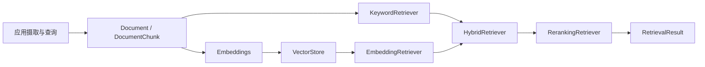

# Retrieval 模块总览

`retrieval/` 提供与业务无关的检索协议和默认实现。文档摄取、索引刷新、权限上下文注入、
知识 API 与业务语料生命周期由应用负责。具体接口见[公共 API](public-api.md)，
选型见[向量存储对比](vector-store-comparison.md)。

## 组件与调用方向

- `KeywordRetriever` 负责词面命中；`EmbeddingRetriever` 组合 `Embeddings` 与 `VectorStore` 进行语义召回。
- `HybridRetriever` 分别扩大两路候选集，再用 RRF 按名次融合。一路失败时可返回另一路结果。
- `RerankingRetriever` 对候选集二次排序；具体 Rerank 服务通过 `Reranker` 契约注入。
- `RetrievalQuery` 携带 namespace、数量、过滤条件与访问上下文；结果包含文档、分数和来源定位。

词面与语义分数的量纲不同，RRF 只使用各路名次，因此不需要直接相加原始分数。
扩大候选集可以提高召回，但会增加向量查询和重排成本，应由应用按数据规模调节。

## 向量后端

`create_vector_store` 的默认映射为测试 `memory`、开发 `chroma`、生产 `pgvector`。
`faiss` 和 `qdrant` 已内置，但必须显式选择 `backend`。除 Memory 外，后端需要对应的
optional extra；pgvector 还需要连接地址、向量维度与异步初始化。

各后端实现相同的 `VectorStore` 接口，过滤执行位置不同。FAISS 在取回全量候选后做
namespace、metadata 和访问过滤；Qdrant 下推 namespace 与访问范围，metadata 过滤使用
有限候选集后的应用侧匹配。强过滤或大语料下应验证延迟和召回完整性。

## 应用接入责任

Core 不负责把知识条目自动写入所有索引，也不提供跨词面索引、向量库和业务数据库的事务。
应用应记录文档 ID、来源 checksum、切分配置和 Embedding 模型版本，并处理重建、删除与失败补偿。
应用还应在每次写入和查询时传入正确的 namespace 和 `AccessContext`，并测试租户隔离。

使用示例见[文档、检索与回调](../guide/documents-retrieval-and-callbacks.md)。
